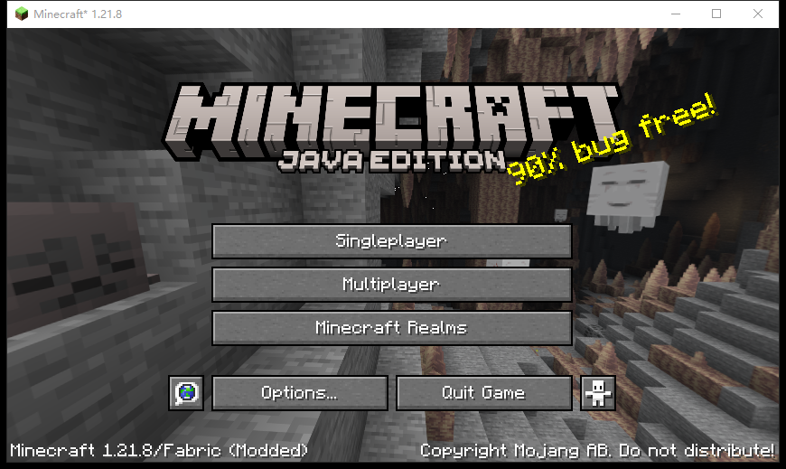
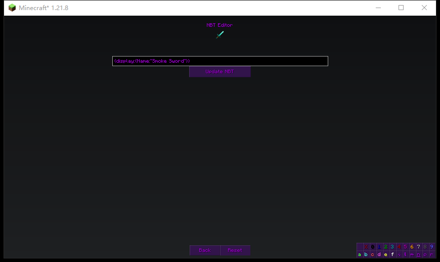
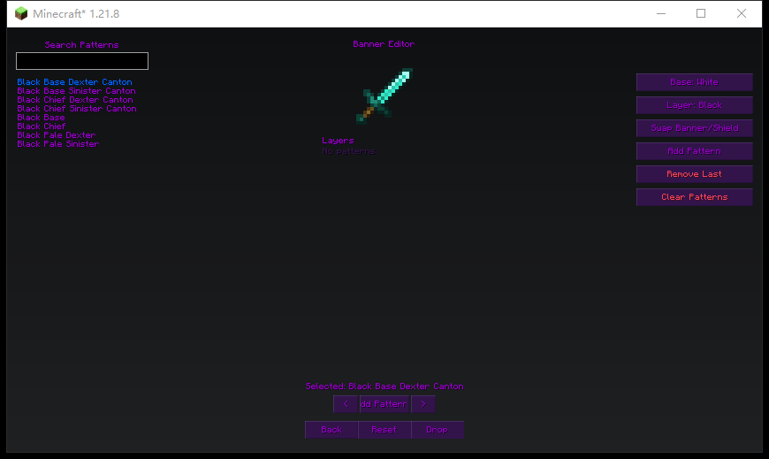
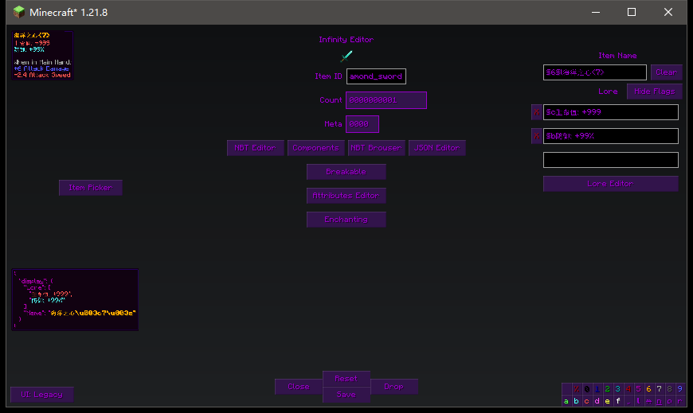

# Infinity Item Editor Re — Minecraft 1.21.8 / Fabric

Infinity Item Editor Re 是一个面向 **Minecraft 1.21.8 Fabric** 的客户端物品编辑 Mod。
本工作区由上游仓库 [SilverWolf-Lv-999/Infinity-Item-Editor-Re](https://github.com/SilverWolf-Lv-999/Infinity-Item-Editor-Re)
的 **Forge 1.20.1 (`master`)** / **Fabric 1.21.4 (`fabric-1.21.4`)** 源码移植而来，不是原作者的官方版本。

## 基本信息

| 项目 | 内容 |
| --- | --- |
| Minecraft | 1.21.8 |
| 加载器 | Fabric Loader 0.20.1 及以上 |
| Fabric API | 0.136.1+1.21.8（编译使用，运行需同版本或更新） |
| Java | 21 |
| Mod ID | `infinity_item_editor_re` |
| 版本 | `1.21.8-Fabric-1.6.3-A` |
| 许可证 | GNU GPL 3.0 |

构建产物：

```text
build/libs/infinity_item_editor_re-1.21.8-Fabric-1.6.3-A.jar
```

本仓库已附带构建好的产物（无需自行构建即可安装）：

```text
dist/infinity_item_editor_re-1.21.8-Fabric-1.6.3-A.jar
dist/infinity_item_editor_re-1.21.8-Fabric-1.6.3-A-sources.jar
```

## 安装

1. 安装 Minecraft 1.21.8 与 Fabric Loader（0.20.1+）。
2. 将 [Fabric API](https://modrinth.com/mod/fabric-api)（0.136.1+1.21.8 或更新）放入 `mods`。
3. 将 `infinity_item_editor_re-1.21.8-Fabric-1.6.3-A.jar` 放入 `mods`。
4. 启动游戏，进入创造模式，手持物品按 `U` 打开编辑器。

完整使用教程见 **[docs/USAGE.md](docs/USAGE.md)**（面板说明、快捷键、配置、排错）。

这是客户端 Mod：服务端不需要安装，但写入物品栏、复制实体装备等操作依赖创造模式权限。

## 功能

与上游 1.20.1 / 1.21.4 版本保持一致：

- 物品编辑器：物品 ID、数量（32 位有符号整数范围）、耐久、名称、Lore、NBT、JSON、隐藏标签、无法破坏等。
- 旧版布局 / 侧边栏布局切换（`UI` 按钮），布局随窗口缩放自适应。
- 附魔、药水效果、自定义属性编辑（可按 Mod 命名空间分组）。
- 专用面板：告示牌、玩家头颅、盔甲架、盔甲纹饰、烟花、容器物品、旗帜/盾牌、饰纹陶罐、刷怪蛋/刷怪箱、村民交易、书本、命令方块、Lore Painter。
- 创造标签页：Realm、Unavailable、Banners、Heads、Thief、Fireworks、Void（均带搜索栏）。
- 快捷键：`U` 编辑、`V` 复制准星目标、`G` 保存到 Realm、`Ctrl+C` / `Ctrl+V` 复制粘贴 `/give`。

数据目录：`.minecraft/infinity-data/realm.nbt`、`.minecraft/infinity-data/void/`。
配置文件：`.minecraft/config/infinity_item_editor_re-client.toml`。

## 构建

需要 JDK 21（Gradle 8.14.3；工程中已配置 `org.gradle.java.home` 指向本机 JDK 21）。

```powershell
$env:JAVA_HOME = 'C:\Program Files\Java\jdk-21.0.11'
.\gradlew.bat build
```

产物位于 `build/libs/`。

开发环境运行客户端：

```powershell
.\gradlew.bat runClient
```

## 更新记录

### 1.6.3（保存兼容第三方服务端）

- 名称/Lore 现在编码为**扁平组件**（如 `{text:"名字",color:"gold",bold:true}`），不再使用 `{text:"",extra:[...]}` 结构，ViaVersion 等版本转换插件更容易正确处理。
- 保存后自动校验服务端回显：若服务端把物品改写了，编辑器会提示「服务器改写了保存的物品（可能是插件/ViaVersion 限制）」，并在日志记录 `the server rewrote the saved item`。
- 已在本地 Fabric 服务端做端到端测试：客户端保存 → 服务端同步回来的 `custom_name` / `lore` 与写入完全一致。

### 1.6.2（保存不再损坏物品）

- 名称/Lore 改为**直接写 `custom_name` / `lore` 组件**，不再经过旧 NBT 往返；保存时不会改写物品原有的 `custom_data`（服务器插件常把数据存在这里，被改写后物品会被重置成白板）。
- 「重置」/清理逻辑不再调用 `ItemStackNbt.set(stack, null)`，避免误清空组件。
- 保存前新增保护：若编辑过程中丢失了原物品的组件（自定义数据、附魔、属性、纹饰等），自动从打开时的原物品补回，并在日志里记录 `restored lost components`。
- 保存时会把最终物品 NBT 写入 `logs/latest.log`（`Infinity Item Editor save: ...`），便于排查服务器是否二次改写。
- 读取 Lore 时优先读 `minecraft:lore` 组件，旧 `display.Lore` 仍兼容。

### 1.6.1（重要修复）

- 修复 1.21.8 下 5 个组件的 NBT 结构变化导致整份组件解析失败、物品被写入 `custom_data`（表现为：名称/Lore/颜色在物品上不显示）：
  `minecraft:dyed_color`（改为整数）、`minecraft:custom_model_data`（`{floats:[...]}`）、
  `minecraft:can_break` / `can_place_on`（单个用 map、多个用 list）、`minecraft:attribute_modifiers`（直接 list）、
  `minecraft:enchantments`（直接 id→等级 map）。
- 修复编辑器中输入 `§` 颜色码不生效（1.21.8 不再自动解析字符串里的 `§`）：现在会转换成真正的组件样式，名称/Lore 预览与成品都会上色，重新打开时又以 `§` 码显示，方便继续编辑。
- 修复编辑器内 tooltip 预览不显示：1.21.6+ 的 `setTooltipForNextFrame` 把 tooltip 存在 `GuiGraphics` 私有字段里，而编辑器缩放时用的是派生 `GuiGraphics`，永远不会被 flush；改为立即绘制。
- 兼容旧数据里带引号的 Lore（`"\"§6…\""`），不再把引号显示出来。
- 单个组件解析失败时不再放弃全部组件：会逐个尝试，能解析的组件（例如名称/Lore）仍会正常写入。

> 已被旧版本写坏（名称/Lore 跑到 `custom_data` 里）的物品：用新版本打开一次编辑器并点「保存」即可修复。

## 验证截图

以下截图来自 Minecraft 1.21.8 + Fabric Loader 0.20.1 的真实开发客户端（冒烟测试）：







### 1.6.1 颜色与 tooltip 预览修复




## 与上游移植有关的说明

1.21.5+ 与 1.21.4 的 API 差异已在本工作区处理，详见 [PORTING.md](PORTING.md)：

- NBT 读取全部改为 `Optional` 风格 API（`getStringOr` / `getCompoundOrEmpty` / `getListOrEmpty` 等），并新增 `NbtCompat`。
- `CompoundTag` / `ListTag` 变为 `final`，实时写回改为「监听 Map/List + 反射构造」方案。
- 隐藏标签改用 `minecraft:tooltip_display.hidden_components` 表示（旧版 `show_in_tooltip` / `hide_additional_tooltip` 已移除）。
- GUI 渲染改用 `GuiRenderState` + `Matrix3x2fStack`（`pushMatrix` / `rotate` / `scale`）。
- 工具提示改用 `setTooltipForNextFrame` / `setComponentTooltipForNextFrame`。
- `ArmorItem` 移除，改用 `DataComponents.EQUIPPABLE` 判定。
- `Inventory` 字段私有化，改用 `getItem` / `setItem` / `setSelectedSlot`；装备写入改用 `setItemSlot`。
- 方块实体与容器 NBT 读写改用 `ValueInput` / `TagValueOutput`。
- `ClickEvent` / `HoverEvent` 改为 record 形式；`Component.Serializer` 改为 `ComponentSerialization.CODEC`。

## 许可证与署名

- 许可证：**GNU GPL 3.0**（[LICENSE](LICENSE)），完整署名与合规说明见 [NOTICE.md](NOTICE.md)。
- 来源链：Ruukas97 的 Infinity Item Editor → SilverWolf-Lv-999 的 Infinity Item Editor Re → 本 1.21.8 Fabric 移植（tlpro418）。
- 本仓库即对应源码；发布 jar 时请同时提供本仓库（或对应 tag）作为源码。

## 原项目与致谢

- 旧版 Infinity Item Editor：<https://github.com/Ruukas97/Infinity-Item-Editor>
- CurseForge：<https://www.curseforge.com/minecraft/mc-mods/infinity-item-editor>
- 1.16.5 相关版本：<https://github.com/Ruukas97/Creative-Editor/>
- 本移植的上游仓库：<https://github.com/SilverWolf-Lv-999/Infinity-Item-Editor-Re>

本项目遵循 GNU GPL 3.0，详见 [LICENSE](LICENSE) 与 [NOTICE.md](NOTICE.md)。请尊重原作者、原上游仓库以及本移植作者的署名和许可。
